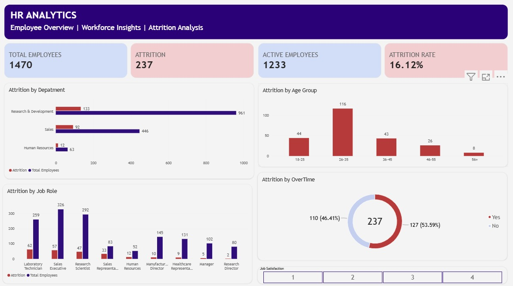

# HR Analytics – Employee Attrition Analysis

## 1. Project Overview

This project analyzes employee attrition using the IBM HR Analytics Employee Attrition & Performance dataset.

The analysis focuses on understanding employee attrition patterns across departments, age groups, job roles, and overtime status. The results can help identify areas that may need further HR evaluation and support employee retention strategies.

The dataset is synthetic and created for analysis and learning purposes. It does not represent actual IBM employee records.

## 2. Project Objectives

- Understand the overall employee attrition rate.
- Analyze attrition across departments and age groups.
- Identify job roles with a high number of employees leaving.
- Explore attrition patterns based on overtime status.
- Provide data-driven recommendations for further HR evaluation.

## 3. Tools & Technologies

- Microsoft Excel
- PostgreSQL
- Power BI
- GitHub

## 4. Dataset

The dataset used in this project is **IBM HR Analytics Employee Attrition & Performance**.

- Source: [Kaggle – IBM HR Analytics Employee Attrition & Performance](https://www.kaggle.com/datasets/pavansubhasht/ibm-hr-analytics-attrition-dataset)
- Total records: 1,470 employees
- Total columns: 35
- Target variable: `Attrition`

The `Attrition` column indicates whether an employee left the company:

- `Yes`: Employee left
- `No`: Employee stayed

## 5. Project Workflow

### 1. Excel Analysis

- Explore the dataset structure and column definitions.
- Review data types and data quality.
- Understand employee attributes related to attrition.
- Prepare the data for further analysis.

### 2. SQL Analysis

- Analyze total employees and employee attrition.
- Compare attrition across departments.
- Analyze attrition by age group and job role.
- Explore attrition based on overtime status.

### 3. Power BI Dashboard

- Create KPI cards to summarize employee attrition.
- Visualize attrition across departments, age groups, and job roles.
- Compare attrition by overtime status.
- Present the findings in an interactive dashboard.

## 6. Dashboard Preview



## 7. Key Business Insights

1. **Overall Attrition**  
   The dataset contains 1,470 employees. A total of 237 employees left the company, while 1,233 employees remained. The overall attrition rate is 16.12%.

2. **Attrition by Department**  
   Research & Development recorded the highest number of employees leaving, with 133 employees out of 961. Sales recorded 92 employees leaving out of 446, while Human Resources recorded 12 out of 63 employees. The number of employees leaving should be considered alongside department size.

3. **Attrition by Age Group**  
   The 26–35 age group recorded the highest number of employees leaving, with 116 employees. This was followed by the 18–25 age group with 44 employees and the 36–45 age group with 43 employees.

4. **Attrition by Job Role**  
   Laboratory Technician recorded 62 employees leaving out of 259 employees. Sales Executive had the largest total workforce, with 326 employees, and 57 employees leaving. This shows that attrition counts differ across job roles.

5. **Attrition and Overtime**  
   Among the 237 employees who left, 127 employees (53.59%) had overtime, while 110 employees (46.41%) did not have overtime. These figures describe the composition of employees who left and do not, by themselves, prove that overtime causes attrition.

## 8. Recommendations

- Conduct further analysis of factors such as overtime, job satisfaction, environment satisfaction, age, and other employee attributes.
- Review attrition patterns in the Research & Development department, which recorded the highest number of employees leaving.
- Investigate attrition among Laboratory Technicians by considering job level, job satisfaction, distance from home, and monthly income.
- Use additional analysis to identify potential retention opportunities. The findings should be treated as descriptive patterns rather than proof of causation.

## 9. Repository Structure

```text
hr-analytics-employee-attrition/
│
├── excel/
│   └── 01_HR_Analytics_Excel_Analysis.xlsx
│
├── sql/
│   └── 02_HR_Analytics_SQL_Analysis.sql
│
├── power-bi/
│   └── 03_HR_Analytics_Dashboard.pbix
│
├── images/
│   └── dashboard-preview.png
│
└── README.md
```

## 10. Skills Demonstrated

- Data exploration
- HR analytics
- Data analysis using Excel
- SQL querying with PostgreSQL
- Data visualization using Power BI
- Business insight development
- Data-driven recommendations
- GitHub project documentation

## 11. Author

**Data Analyst Portfolio Project**
